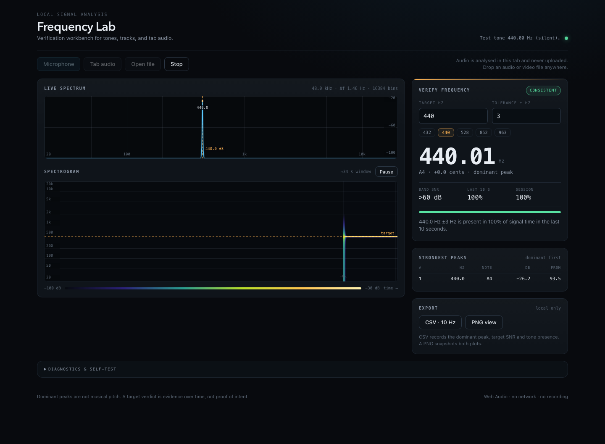

# Frequency Lab

A single-file, local-only frequency detector for music and video. Point it at a
microphone, a browser tab, or an audio/video file and it shows the dominant
frequency, the nearest musical note and cents offset, a log-scale spectrum, a
live spectrogram, and a verdict on whether a chosen target frequency is
actually present.

There is no build step, no tracking, and no network access — everything runs in
the page.



## Run it

Open `frequency-lab.html` directly in Chrome, Edge, or Safari:

- **Open file** works from `file://` (decode and analysis of local media).
- **Microphone** and **tab audio** need a secure origin, so serve the folder:

```sh
python3 -m http.server 8000
# then open http://localhost:8000/frequency-lab.html
```

Append `?demo=440` to open with a built-in oscillator, or `?selftest=1` to run
the internal 440/432/528 Hz self-test.

## What it shows

- Dominant peak, note name, and cents deviation, plus the top peaks above the
  noise floor.
- Target verification: SNR and prominence at the target, a percentage across
  the last 10 s and the whole session, and a verdict
  (consistent / intermittent / not detected / collecting).
- Log-frequency spectrum from 20 Hz to 20 kHz, driven by a 32k-point FFT for
  about 1.46 Hz resolution at 48 kHz.
- Scrolling spectrogram with a time axis and a 10 s bucket history.
- CSV export (10 Hz session rows) and PNG capture of both plots.

## Verification

Both scripts use only Node's standard library (the UI test drives a local Chrome
over CDP and needs Chrome installed at the standard macOS path).

```sh
node verify-dsp.mjs   # DSP core extracted from the HTML: 27 checks
node verify-ui.mjs    # browser smoke test, screenshots, mic/file paths
```

`verify-ui.mjs` writes `freqlab-preview.png` and `freqlab-preview-mobile.png`.

## Files

| File | Purpose |
| --- | --- |
| `frequency-lab.html` | The whole app: markup, styles, DSP, rendering |
| `verify-dsp.mjs` | Headless checks of the embedded DSP core |
| `verify-ui.mjs` | Chrome/CDP smoke test across mic, tab, file, export |
| `freqlab-preview*.png` | Reference screenshots of the desktop and mobile views |
