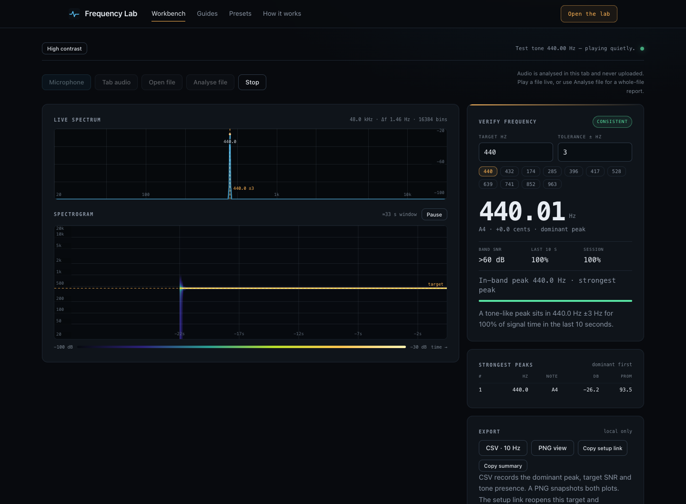

# Frequency Lab

A local-first frequency verification workbench for the browser, plus a small
site around it: methodology, a claims table, six guides and an offline edition.

**The question it answers:** *is this audio really at frequency X, and how much
of the time?* Not "what key is this song in" and not "is this frequency good for
you" — those are different problems, and the tool is explicit about the line.



## Run it

```sh
npm install
npm run dev          # http://127.0.0.1:5173
```

Production build and preview:

```sh
npm run build        # static site in dist/ + single-file edition
npm run preview      # http://127.0.0.1:4173
```

Microphone and tab capture need a secure context. `localhost` qualifies; opening
`dist/index.html` as a file does not. The standalone edition in
`dist/download/frequency-lab.html` is the exception: file analysis, exports and
the self-test work from `file://`, while capture shows a clear notice.

## What is in the box

| Path | Purpose |
| --- | --- |
| `index.html` | Landing page with a permission-free tone demo |
| `app/` | Workbench markup (the shared view lives in `src/app/view.html`) |
| `guides/` | Six articles, generated nav/metadata, hand-written prose |
| `presets/` | Claims table generated from `src/site/presets.ts` |
| `how-it-works/` | FFT, evidence and limits |
| `offline/`, `privacy/`, `404.html` | Offline edition, privacy, not found |
| `src/dsp/core.ts` | Pure measurement core, shared by app, demo and tests |
| `src/app/` | Workbench state, session lifecycle, rendering, UI |
| `src/site/` | Routes, chrome, presets, service-worker registration |
| `scripts/` | Build glue, link check, icons, screenshots |
| `test/` | Vitest unit tests |
| `e2e/` | Playwright suite |

The measurement core was extracted verbatim from the original single-file build
and is frozen by `test/dsp.test.ts` (27 assertions). The rest of the workbench
was ported without behaviour changes.

## Measurement, briefly

- 32,768-point FFT for the fine spectrum: ~1.46 Hz per bin at 48 kHz, ~0.68 s
  window. 8,192-point FFT for the spectrogram.
- Peak picking above a median noise floor, with salience and parabolic
  interpolation; the headline is the strongest peak, not a pitch estimate.
- Target evidence is counted over 100 ms buckets and ignores silence; 80% /
  20% thresholds separate consistent, intermittent and not-detected.
- dB values are relative to full scale, not calibrated SPL.

The full method, including what it cannot tell you, is in
[`how-it-works/index.html`](how-it-works/index.html).

## Tests

```sh
npm test             # Vitest: DSP core + URL/preset logic
npm run test:e2e     # Playwright: site, workbench, exports, mic, file, PWA
npm run typecheck    # tsc --noEmit
npm run check:links  # internal links + page metadata in dist/
```

The end-to-end suite drives Chrome with a fake 440 Hz microphone, opens real
WAV fixtures, exercises CSV/PNG downloads and checks that a corrupt file is
cleaned up. Visual snapshots are generated on macOS and skipped in CI:

```sh
npx playwright test e2e/visual.spec.ts --update-snapshots
node scripts/screenshots.mjs      # refreshes the images in public/
```

## Deploy

Static output, no server. The deployment uses Cloudflare Workers with static
assets, built from the private GitHub repository by Workers Builds; `wrangler.toml`
sets the asset directory and the 404 behaviour. See [DEPLOY.md](DEPLOY.md).

Set `SITE_URL` at build time to the production origin. It is used for canonical
links, Open Graph, `sitemap.xml` and `robots.txt`.

## Privacy

Audio never leaves the browser: no uploads, no accounts, no cookies, no
third-party scripts. Preferences (target, tolerance, palette) are kept in
`localStorage`; nothing else persists. The service worker caches interface files
for offline use and contains no audio. See `/privacy/`.

## Status

Shipped: live verification workbench, whole-site content, PWA, offline edition,
shareable setup links, deep-linkable presets, contrast palette, keyboard
shortcuts, CI and link checks.

Next milestones (not built yet): faster-than-real-time whole-file analysis with
a zoomable timeline and band-energy mix; chroma/key estimation with a
configurable A4 reference; multiple simultaneous targets; report links.

There is no license file yet; the repository is private and the code is not
published for reuse.
